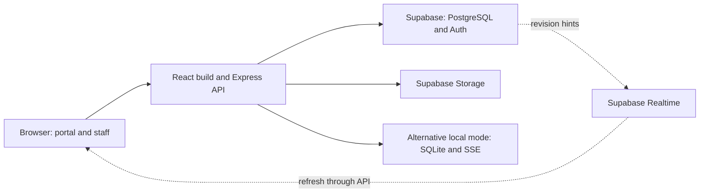

# restoOS

A restaurant operations web app connecting customer orders, kitchen preparation, delivery and manual payment in one shared workflow.

This README serves as the project overview, setup guide and documentation index. Follow the links throughout or use the [documentation map](#documentation-map) for detailed guides. All project documentation must be maintained in English; preserve actual API identifiers, paths, spreadsheet column names and quoted Indonesian interface labels.

## Contents

- [What the application does](#what-the-application-does)
- [Architecture and data](#architecture-and-data)
- [Choose a setup](#choose-a-setup)
- [Prerequisites and configuration](#prerequisites-and-configuration)
- [Local setup with SQLite](#local-setup-with-sqlite)
- [Cloud setup with Supabase and Vercel](#cloud-setup-with-supabase-and-vercel)
- [Self-host on a VPS](#self-host-on-a-vps)
- [Self-host Supabase](#self-host-supabase)
- [Other infrastructure options](#other-infrastructure-options)
- [Initialize and verify the restaurant](#initialize-and-verify-the-restaurant)
- [Demo mode](#demo-mode)
- [Maintenance, backup and recovery](#maintenance-backup-and-recovery)
- [Documentation map](#documentation-map)

## What the application does

restoOS targets **one restaurant and one kitchen**. Customers order without an account; staff coordinate service through three workspaces.

| Surface | Main capabilities |
| --- | --- |
| Customer portal, `/portal` | Photographic menu, category/search, description languages, dish details, cart, notes and submission |
| Kitchen — Dapur | Production tickets, portion readiness, ready-for-delivery queue, menu demand, sound activation, ordering pause and availability |
| Waiter — Garson | Customer list, additional orders, delivery, manual payment, renaming, eligible cancellation and transaction merging |
| Management — Manajemen | Business overview, read-only history, receipt/expense ledger, catalog/photos, Excel import/export, branding, staff and finance settings |

The root URL redirects to the portal. Staff sign in at the unlisted `/ruang-staf`; normal portal navigation does not advertise it. **Every admitted staff account can select all three workspaces.** The selection belongs to the login session and can be changed; it is not a permanent employee permission tier.

### The service model

A **transaction** (`tab`, shown as “Transaksi”) groups a customer's active orders. An **order** is one timestamped submission. A **portion** is one serving with independent service and payment states.

```text
Submit → immediately accepted → prepare → ready → delivered
                    Payment may happen before or after delivery
```

A transaction closes only when every portion is cancelled or **both paid and delivered**. Additional submissions stay in the active transaction. Older debt is grouped separately after the five-hour display boundary without expiring or splitting transactions. Waiters can merge active transactions while preserving orders and payments.

The portal exposes catalog and minimal visit identity, not order history, bills or payment details. Staff handle those. Stale portal submissions are rejected rather than silently starting a new transaction.

Sales follow order dates, receipts follow payment dates, and expenses follow their event dates. Net recorded cash movement is receipts minus expenses, not profit or bank balance. Reports export an XLSX snapshot with raw records and formulas. Menu imports preview/validate the whole file before saving; historical portion prices remain intact.

**Current limits:** no offline browser operation, payment gateway, ingredient inventory, refunds, expense correction, unmerge or multi-restaurant isolation. Paid/delivered portions cannot be cancelled. Prices are whole-number final amounts in one configured currency; changing currency does not convert historical amounts.

Details: [product and workflows](docs/01-PRODUCT-AND-WORKFLOWS.md), [product brief](docs/PRODUCT.md), and [financial definitions](docs/03-DATA-MODEL.md#6-financial-definitions-and-invariants).

## Architecture and data

The application is a **modular monolith**: React 19/Vite 7 in the browser and Express 5 on Node 24 for the API. It uses neither Next.js nor a separate microservice fleet.



Cloud business data lives in private PostgreSQL tables containing entity JSONB payloads, generated relationship/value columns, constraints and indexes. Orders and portions are separate cloud entities. Local SQLite instead stores one serialized application-state document in a single row; it is not a relational copy of the cloud schema. The two modes do not synchronize automatically.

Reads select data by workspace/page and support small unchanged-version responses. Cloud writes still read a full snapshot, apply domain rules, compute row changes and commit under a global revision lock, retrying conflicts. Notifications carry revision hints, not business records. Screens reconcile through the authorized API; local mode uses process-local SSE.

Security includes server-side workspace checks, HttpOnly ownership/session cookies, persistent cloud sessions, input validation and basic abuse limits. Browser keys cannot directly execute privileged business RPCs. The server's secret key must stay server-only.

Full-snapshot writes, growing history, global contention and request-time image/XLSX processing are current scaling considerations. Local mode is intended for one process. The guides describe source configuration, not proof of the current public deployment.

Details: [system design and API map](docs/02-SYSTEM-DESIGN.md), [data model](docs/03-DATA-MODEL.md), and [security model](docs/05-SECURITY-OPERATIONS-AND-DEVELOPMENT.md#1-security-model).

## Choose a setup

| Path | Suitable use | Current support / extra work |
| --- | --- | --- |
| Local Node + SQLite | Development, evaluation, controlled local operation | Existing adapter and local login; no standalone photo-upload backend |
| Vercel + managed Supabase | Existing cloud deployment architecture | Configure migrations, Auth, Storage, Realtime and environment |
| VPS/Node host + managed Supabase | Own the application server while retaining cloud services | Existing standalone entry; add proxy trust, HTTPS, headers and process management |
| VPS/on-prem Node + SQLite | Self-host core operations with a local database | Persistent disk, one process, local bootstrap and independent backups |
| Node + self-hosted Supabase | Control application and backend infrastructure | Full Supabase deployment/operations and compatibility verification |
| Another PostgreSQL/Auth/media stack | Infrastructure migration | New adapters and security/integration work; not a credential-only switch |
| Containers | Package the standalone service | Author/test a Dockerfile and runtime configuration; none is supplied |

Supabase is more than the database in this project: it also provides staff Auth, media, RPC transport and notifications. Switching only the application host is considerably smaller than replacing those integrations.

Details: [infrastructure alternatives](docs/04-INFRASTRUCTURE-AND-ALTERNATIVES.md).

## Prerequisites and configuration

1. Install **Node.js 24** with npm and obtain this repository. Run commands from its root.
2. Install the locked dependencies with `npm ci`.
3. Choose one setup below before creating accounts or real transactions.
4. Create a private `.env` from [.env.example](.env.example) for standalone use, or configure runtime variables in the host dashboard. Do not overwrite an existing environment without reviewing it.

| Variable | Purpose |
| --- | --- |
| `SUPABASE_URL` | Selected project's API URL |
| `SUPABASE_SECRET_KEY` | Privileged server credential for cloud data/Storage |
| `SUPABASE_PUBLISHABLE_KEY` | Browser Realtime and anonymous-access checks |
| `RESTO_DB` | Explicit SQLite path; overrides cloud database selection |
| `HOST`, `PORT` | Standalone listener; defaults to `127.0.0.1:3000` |
| `RESTO_SECURE_COOKIE` | Set to `1` behind HTTPS outside Vercel |
| `APP_DEMO_MODE` | Exact value `true` selects isolated demo; otherwise normal mode |

Selection order is **demo → configured cloud without RESTO_DB → SQLite**. Media enablement separately checks cloud credentials: a SQLite database override alone does not isolate image operations. For fully local use, leave Supabase credentials unset in both the process and `.env`.

The standalone server loads `.env`, not explicitly `.env.local`; `RESTO_DB=:memory:` skips its `.env` load. Never expose secrets through `VITE_` variables. Preview/test and production environments should use separate data and credentials.

Details: [configuration contract](docs/04-INFRASTRUCTURE-AND-ALTERNATIVES.md#2-configuration-contract).

## Local setup with SQLite

### 1. Prepare a local environment

Leave all Supabase variables unset and set these optional values in `.env`:

```dotenv
APP_DEMO_MODE=false
RESTO_DB=data/resto.sqlite
HOST=127.0.0.1
PORT=3000
RESTO_SECURE_COOKIE=0
```

### 2. Install and start

```sh
npm ci
npm run dev
```

Open `http://127.0.0.1:3000/ruang-staf` **on the server computer**. A new database has no staff, catalog or orders. Create the initial admin, sign in and choose Management. Configure currency, identity and catalog before service.

### 3. Verify a production build

Stop the development process before using the same port:

```sh
npm test
npm run build
npm start
```

`npm start` serves the compiled frontend and Express API. The default SQLite file persists across restarts; deleting it is not part of normal startup.

### 4. Optional: make it reachable on a local network

Finish the first-account setup while bound to loopback. Then bind `HOST=0.0.0.0`, restart and configure the host firewall for the intended private network. Clients use the server's LAN address instead of their own localhost. A browser on another device cannot perform the initial local bootstrap.

For HTTPS through a reverse proxy, apply the proxy-trust and cookie steps in the VPS section. Plain local HTTP uses `RESTO_SECURE_COOKIE=0`. LAN access is not offline synchronization: every client still needs the running server. Kitchen notifications/audio require the browser to remain usable and audio to be activated.

SQLite-only mode lacks menu-photo uploads; Supabase Storage or a new media adapter is needed for that feature. Use a single Node process and consistent off-device SQLite backups.

Details: [local development](docs/05-SECURITY-OPERATIONS-AND-DEVELOPMENT.md#2-local-development) and [SQLite hosting](docs/04-INFRASTRUCTURE-AND-ALTERNATIVES.md#6-alternative-b-localon-prem-or-hosted-sqlite).

## Cloud setup with Supabase and Vercel

### 1. Prepare Supabase

Create a dedicated project. In its SQL editor or a controlled migration runner, apply **every file in [supabase/migrations](supabase/migrations) in filename order**, once per migration. Do not stop after the initial schema: later files change Auth context, finance, reads and acceptance behavior.

Confirm the private schema/RPCs, public `menu-images` bucket, Realtime authorization and scheduled maintenance are established. Resolve migration errors before deploying the app; do not grant browser access to private tables as a workaround.

### 2. Prepare staff authentication

Disable public Auth signups. In Supabase Authentication, create the first email/password user with confirmation enabled. No staff metadata marker is required. Every confirmed, unbanned account is staff and can choose Management, so use a dedicated project.

### 3. Configure the application environment

Set these values in Vercel for the intended environment:

```dotenv
APP_DEMO_MODE=false
SUPABASE_URL=https://YOUR_PROJECT.supabase.co
SUPABASE_SECRET_KEY=YOUR_SERVER_ONLY_SECRET
SUPABASE_PUBLISHABLE_KEY=YOUR_PUBLISHABLE_KEY
```

**Leave `RESTO_DB` absent.** Normal Vercel operation requires the cloud backend; persistent SQLite on the function filesystem is not supported. The publishable key enables Realtime; without it screens fall back to version reconciliation.

For local testing against a separate Supabase project, place the same variables in `.env` and run `npm run dev`. Cloud accounts still use Auth; local admin setup is disabled in this mode.

### 4. Configure and deploy Vercel

Import the repository into the intended Vercel project, or install/authenticate the Vercel CLI and link this checkout to that project. Select Node 24 and retain the repository's build/output/routing settings in [vercel.json](vercel.json). The configured function region is Frankfurt and its request duration is 30 seconds; compare region placement with your database.

Run local checks, then deploy through the dashboard or linked CLI:

```sh
npm test
npm run build
vercel project inspect --non-interactive
vercel deploy --prod
```

Set environment values before deployment and redeploy after changing them. If using previews, provision separate backend data rather than pointing them at the live restaurant. Manual CLI deployment does not automatically establish Git-triggered deployment.

### 5. Initialize and validate

Open the deployed `/ruang-staf`, sign in with the confirmed Auth account, choose Management and follow the [restaurant initialization checklist](#initialize-and-verify-the-restaurant). Add subsequent staff through the application. Check public ordering, authenticated actions, images and notification recovery.

Details: [cloud account setup](docs/05-SECURITY-OPERATIONS-AND-DEVELOPMENT.md#3-first-cloud-setup), [deployment runbook](docs/05-SECURITY-OPERATIONS-AND-DEVELOPMENT.md#4-deployment-procedure), and [Vercel CLI reference](https://vercel.com/docs/cli/deploy).

## Self-host on a VPS

The following is a **Linux deployment template** for one Node process behind a same-machine HTTPS reverse proxy. Paths, service accounts, DNS and binaries must match your server. These configuration examples are not installed by the repository.

### 1. Prepare the host

Install Node 24, npm, Git, a reverse proxy such as Caddy, and a process manager such as systemd. Create a dedicated application account, place the checkout at an application path such as `/opt/restoos`, and give that account only the required file/directory permissions. Point a domain at the VPS and allow the required SSH/HTTP/HTTPS traffic. Keep the Node port private.

### 2. Choose persistence

For **SQLite**, create a persistent directory owned by the application account and use:

```dotenv
APP_DEMO_MODE=false
RESTO_DB=/var/lib/restoos/resto.sqlite
HOST=127.0.0.1
PORT=3000
RESTO_SECURE_COOKIE=0
```

Leave Supabase credentials unset. The directory must survive deployments and be writable by the service.

For **managed Supabase**, complete its migration/Auth steps above, configure its three variables, and leave `RESTO_DB` absent. Use the same loopback listener. The VPS then runs only the app; database, Auth, Storage and Realtime remain managed.

### 3. Build and bootstrap privately

From the checkout, install, test and build:

```sh
npm ci
npm test
npm run build
npm start
```

For a new SQLite database, connect from your workstation through an SSH tunnel:

```sh
ssh -L 3000:127.0.0.1:3000 YOUR_SSH_USER@YOUR_VPS
```

Open `http://127.0.0.1:3000/ruang-staf` locally and create the initial admin through the tunnel. Keep Secure cookies off for this temporary HTTP bootstrap. Complete it before exposing the reverse proxy. Cloud mode instead uses the confirmed Supabase account and has no local setup endpoint.

Stop the foreground server before starting its service.

### 4. Configure proxy trust explicitly

The current app automatically trusts a proxy **only on Vercel**. Before publishing behind a same-machine proxy, adapt the existing initialization in `server/app.js` to the actual topology. For the loopback-only template here, replace its Vercel-only trust line with:

```js
if (process.env.VERCEL) app.set('trust proxy', 1);
else app.set('trust proxy', 'loopback');
```

This is a deployment-specific code adaptation, not an existing environment switch. It allows Express to interpret the proxy's protocol/IP information for origin checks and throttling. Keep the listener private and ensure the proxy supplies trustworthy forwarded headers. A remote proxy or additional CDN needs its own bounded trust configuration; do not copy the loopback setting to a different topology.

Details: [Express proxy guidance](https://expressjs.com/en/guide/behind-proxies/) and [host migration requirements](docs/04-INFRASTRUCTURE-AND-ALTERNATIVES.md#5-alternative-a-move-only-the-application-host).

### 5. Run as a managed service

Set `RESTO_SECURE_COOKIE=1` in the private `.env` for public HTTPS. Restrict that file to the application owner and required administrators. An illustrative `/etc/systemd/system/restoos.service` is:

```ini
[Unit]
Description=restoOS
After=network.target

[Service]
Type=simple
User=restoos
WorkingDirectory=/opt/restoos
Environment=NODE_ENV=production
ExecStart=/usr/bin/node /opt/restoos/server/index.js --production
Restart=on-failure
RestartSec=5

[Install]
WantedBy=multi-user.target
```

Replace the user, checkout and Node binary paths with real ones; inspect `command -v node` rather than assuming the example path. The working directory makes the standalone entry load its private `.env`. Ensure the service can write the SQLite directory if selected.

After saving the unit:

```sh
sudo systemctl daemon-reload
sudo systemctl enable --now restoos
sudo systemctl status restoos
```

Use `journalctl -u restoos` for service logs.

### 6. Put HTTPS in front

A minimal Caddyfile for the same-machine listener is:

```caddyfile
restaurant.example.com {
    header {
        X-Content-Type-Options nosniff
        Referrer-Policy strict-origin-when-cross-origin
        X-Frame-Options DENY
    }
    @staff path /ruang-staf
    header @staff X-Robots-Tag "noindex, nofollow, noarchive"
    reverse_proxy 127.0.0.1:3000
}
```

Replace the example hostname, complete DNS/TLS prerequisites and validate/reload Caddy using its installation's service procedure. Proxy the entire app so frontend and API stay on the same origin. In SQLite mode, public exposure must wait until the first admin exists because the proxy itself connects from loopback.

See [Caddy's reverse-proxy guide](https://caddyserver.com/docs/quick-starts/reverse-proxy). Serving HTTPS does not replace the explicit Express trust configuration above.

### 7. Verify and operate

Check the public portal, staff login, a permitted mutation, browser notifications and cookie behavior over HTTPS. Verify service restart and database persistence. Schedule off-device backups and test recovery. SQLite requires one process; cloud mode can use external persistence but still retains snapshot-write/global-revision limits.

A container or managed Node host can use the same application pattern, with platform-specific listener, proxy, disk and restart configuration. Detailed tradeoffs: [infrastructure guide](docs/04-INFRASTRUCTURE-AND-ALTERNATIVES.md).

## Self-host Supabase

This is a separate backend deployment, not simply installing PostgreSQL beside the app.

1. Follow the official [Supabase Docker deployment guide](https://supabase.com/docs/guides/self-hosting/docker) on a prepared host with persistent volumes, secured keys, DNS/TLS and restricted administration.
2. Configure the database/API, Auth, Storage, Realtime and cron capabilities used by this repository. Disable public Auth signups.
3. Apply the application migrations in order. Verify Supabase-specific roles, Auth-table access through private context, broadcasts, bucket policies and maintenance jobs against the selected service versions.
4. Create the first confirmed staff account. Configure the app with the self-hosted API URL and appropriate server/publishable keys; leave `RESTO_DB` absent.
5. Run the app on Vercel or a separate/private Node service using the corresponding steps above. Use a publicly reachable, correctly secured API/Realtime endpoint for browser connections.
6. Test the full service flow in an isolated environment, then establish database, media and identity backups, monitoring and an upgrade process.

For an existing restaurant, migrate application records, image objects and Auth identities separately, update image URLs when necessary and expire old app sessions. This repository has no turnkey full-project migration/restore tool. Self-hosted service compatibility is a verification task, not a certified one-command deployment.

Details: [self-hosted Supabase requirements](docs/04-INFRASTRUCTURE-AND-ALTERNATIVES.md#8-alternative-d-self-host-supabase) and [recovery](docs/05-SECURITY-OPERATIONS-AND-DEVELOPMENT.md#7-backup-and-recovery).

## Other infrastructure options

### Another application host

A Render-style Node service, another always-on host or a container platform can retain Supabase and use `npm ci`, `npm run build` and `npm start`. Configure the assigned port/public listener if the platform requires it, then adapt proxy trust, HTTPS, headers and health checks. With SQLite, explicitly provision a persistent mounted disk and keep one process. The repository supplies no Dockerfile.

### Another database, Auth or media provider

A PostgreSQL service such as Neon, another Auth provider, or S3-compatible media storage can form an alternative architecture, but **the current code cannot switch by setting a DATABASE_URL**.

A migration requires these steps:

1. Select the database transport and implement an adapter preserving atomic writes, conflict retries and selected/versioned reads.
2. Adapt migrations that depend on Supabase roles, Auth tables, Storage, Realtime and cron.
3. Integrate staff admission, account creation/revocation and application sessions with the chosen Auth system.
4. Replace media upload/delete, URL validation, cleanup and backup behavior, or intentionally retain Supabase Storage.
5. Provide authorized notifications or deliberately tested version polling; process-local SSE does not connect separate replicas.
6. Migrate records, media and identities; compare financial totals and test concurrency/ownership before switching traffic.

Keeping some Supabase services can reduce replacement work, but session validation currently joins its Auth table from the business database, so moving only the database still needs redesign. Worker/edge deployments also need a runtime audit for built-in SQLite, synchronous APIs, sharp and workbook processing.

Details: [database replacement](docs/04-INFRASTRUCTURE-AND-ALTERNATIVES.md#9-alternative-e-another-postgresql-provider), [individual services](docs/04-INFRASTRUCTURE-AND-ALTERNATIVES.md#10-replacing-individual-services), [containers](docs/04-INFRASTRUCTURE-AND-ALTERNATIVES.md#7-alternative-c-containers), and [edge runtimes](docs/04-INFRASTRUCTURE-AND-ALTERNATIVES.md#11-edgeruntime-alternatives).

## Initialize and verify the restaurant

After any supported setup:

1. Sign in at `/ruang-staf` and choose Management.
2. Set restaurant identity and **base currency before recording real activity**. Configure payment methods and expense categories.
3. Add catalog items or preview/import XLSX. The template uses the actual columns `Nama menu`, `Kategori`, `Harga`, `Deskripsi`, `Tersedia`; optional `Deskripsi [en]`-style columns add description translations. Limits are 1,000 rows and 500,000 bytes.
4. With Storage configured, test a menu photo upload. Static PNG/JPG/WebP up to 2 MB becomes resized WebP, at most 1280 px.
5. Add staff. Cloud staff use confirmed Auth email/password; SQLite staff use local usernames/passwords.
6. In an isolated trial, submit a portal order, inspect it in Kitchen, mark portions ready, deliver them as Waiter and record payment. Confirm closure occurs only after payment and delivery.
7. Activate kitchen audio and test actual staff devices, reconnect behavior and responsive layouts.
8. Review sales/receipts/debt and export a report. Confirm backups can be restored before relying on the service.

The visual system uses ivory surfaces, Newsreader/Manrope typography, thin rules and restrained accents, with keyboard focus, explicit statuses and reduced-motion paths. Source conventions are not a substitute for device/accessibility evaluation.

Details: [catalog and workflows](docs/01-PRODUCT-AND-WORKFLOWS.md), [design system](docs/DESIGN.md), [report semantics](docs/03-DATA-MODEL.md#7-reporting-time-and-xlsx-behavior), and [verification tools](docs/05-SECURITY-OPERATIONS-AND-DEVELOPMENT.md#9-verification-tools-and-their-effects).

## Demo mode

Set `APP_DEMO_MODE=true` on a dedicated local or cloud environment, then restart/redeploy. Remove cloud credentials from that environment as an additional separation measure.

The demo supplies fictional browser-persisted data and staff workspace selection without real login. Guards prohibit live database/Auth/Storage access; image upload is disabled. The banner provides reset and staff entry. Each browser has its own dataset, and clearing storage resets it. There is no cross-device shared demo database.

Demo still requires the Node API; it is not a static-only/offline application. Normal installations remain empty and authenticated.

Details: [demo architecture](docs/02-SYSTEM-DESIGN.md#8-demo-mode) and [asset credits](docs/ASSET-CREDITS.md).

## Maintenance, backup and recovery

- **Code changes:** run `npm test` and `npm run build`; deploy the intended revision and verify its environment.
- **Cloud checks:** `/api/health` tests a database RPC, not every integrated service. Optional security/Realtime/deployment scripts have distinct effects; use the [verification table](docs/05-SECURITY-OPERATIONS-AND-DEVELOPMENT.md#9-verification-tools-and-their-effects) before running them.
- **Cloud backup:** `npm run backup` loads private `.env` configuration and exports application state plus referenced Supabase images under `data/backups`, including image checksums. Schedule it separately and keep protected off-device copies. It is not a complete Supabase/Auth backup.
- **SQLite backup:** use a consistent SQLite backup method or stop the process cleanly before copying. Account for WAL state; the cloud helper is not a SQLite backup command.
- **Recovery:** prepare an empty compatible target, restore/verify records and media, handle Auth identities separately, discard old sessions and compare financial totals before switching traffic. There is no automatic production restore.
- **Monitoring:** watch request failures/latency, snapshot size, conflicts, notification fallback, media cleanup and backup age. Refund/correction flows are not supplied as an operational escape hatch.
- **Availability:** clients need a reachable server/backend. Define a restaurant fallback and recovery procedure rather than assuming local drafts or a free hosting plan guarantee service continuity.

Details: [operating runbook](docs/05-SECURITY-OPERATIONS-AND-DEVELOPMENT.md) and [cutover planning](docs/04-INFRASTRUCTURE-AND-ALTERNATIVES.md#12-cutover-checklist-for-any-alternative).

## Documentation map

| Document | Read for |
| --- | --- |
| [Product and workflows](docs/01-PRODUCT-AND-WORKFLOWS.md) | User journeys, domain terminology and product limits |
| [System design](docs/02-SYSTEM-DESIGN.md) | Module boundaries, API, concurrency, synchronization and demo isolation |
| [Data model](docs/03-DATA-MODEL.md) | Entities, physical storage, constraints and financial/reporting definitions |
| [Infrastructure and alternatives](docs/04-INFRASTRUCTURE-AND-ALTERNATIVES.md) | Deployment topology and additional work for each alternative |
| [Security and operations](docs/05-SECURITY-OPERATIONS-AND-DEVELOPMENT.md) | Setup, authentication, deployment, maintenance, backups and tests |
| [Product brief](docs/PRODUCT.md) | 5W1H, product scope, decisions and tradeoffs |
| [Design system](docs/DESIGN.md) | Tokens, layouts, components, motion and accessibility conventions |
| [UI/UX case study](docs/PORTFOLIO-UIUX-CASE-STUDY.md) | Design rationale and a portfolio capture plan, without claimed measured outcomes |
| [Asset credits](docs/ASSET-CREDITS.md) | Font licenses and normal/demo photography sources |

Documentation was checked against the repository working tree on 28 October 2026. Source configuration does not prove that the same revision, migrations or settings are live. Provider accounts, production data, billing and service availability were not audited. Alternatives are migration designs unless explicitly identified as existing implementations; provider pricing and quotas require current verification.

The documentation refresh passed all 34 local tests on Node 24 and the frontend production build; that does not establish live provider integration, device behavior or accessibility compliance. Setup examples explain how to operate or adapt the repository; they do not certify an already-configured VPS, provider account or live deployment.
