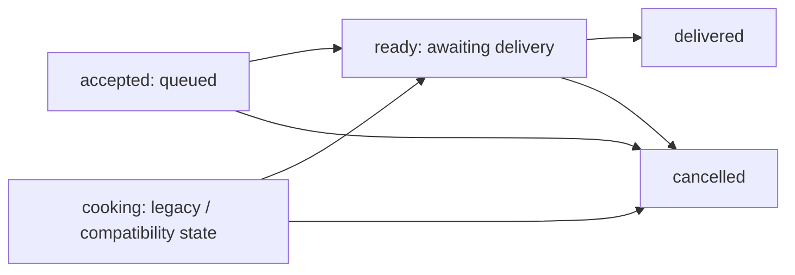

# 01 — Product and workflows

[Index](INDEX.md) · Next: [System design](02-SYSTEM-DESIGN.md)

## 1. Product purpose and scope

restoOS is a web application for one restaurant and one kitchen. It maintains a shared record from order submission through food preparation, delivery and manual payment.

The product connects activities that otherwise live in separate order notes, kitchen queues, delivery lists and payment records. The same individual food portions carry service status and payment obligations. Payment and delivery can happen at different times without losing their relationship.

It is not a complete restaurant ERP. Inventory, recipes/BOM, purchase orders, online payment processing, refunds and offline operation are not implemented. There is no branch or tenant model separating several restaurants inside one deployment.

## 2. Users and workspaces

| User | Main work | Entry |
| --- | --- | --- |
| Dine-in customer | Browse dishes, build a cart, provide a name and notes, submit an order | `/portal`, without an account |
| Kitchen | Track production, mark portions ready, cancel eligible portions, control availability and ordering pause | Sign in → Dapur |
| Waiter | Create orders, manage customers, deliver food, record payments, rename and merge transactions | Sign in → Garson |
| Management | Review overview/history, record expenses, manage catalog/settings/staff, export reports | Sign in → Manajemen |

The root URL redirects to the portal. Normal public navigation does not advertise the staff address, `/ruang-staf`. Server authentication remains the actual security boundary.

**A workspace is session context, not a permanent account permission tier.** Every authorized staff account can choose all three spaces. Each login requires a choice; refreshing retains it, and the switch-workspace control changes it. This protects task context but does not separate employees who may access management finances from employees who may not.

## 3. Domain terminology

| Product concept | Code term | Meaning |
| --- | --- | --- |
| Customer transaction, shown as “Transaksi” | `tab` / `tabs` | An active container for one customer's submissions and obligations |
| Order, shown as “Pesanan” | `order` / `orders` | One timestamped submission with its own identity |
| Portion | `unit`; cloud table `portions` | One serving with its own service and payment state |
| Payment | `payment` | Money received for selected portions of one order |
| Expense | `expense` | A paid operating expense recorded by management |
| Portal transaction session | `portalSession` | The browser's relationship to an ongoing customer transaction |

A customer name is not a permanent CRM identity. Names are normalized and must be unique while their transactions are active. A closed name can be reused. IDs establish identity; display names and order slugs do not.

## 4. Ordering workflow

1. The portal loads the catalog and minimal session identity.
2. The customer selects available dishes, quantities and notes. A browser draft preserves unfinished choices.
3. Submission includes the displayed prices, `requestId` and `sessionTabId`.
4. The server checks current prices, availability, ordering pause, abuse limits and session ownership.
5. The transaction, order and portions are created atomically where needed. Menu name, category and price are copied into each portion.
6. A valid new order is immediately `accepted` and enters the kitchen queue. The current path does not wait for an acceptance timer.
7. The portal confirms submission. Staff handle order detail, history, outstanding balances and payment.

The domain allows up to 30 item entries, 30 portions per entry, and 100 portions per submission. Notes are truncated to 200 characters. Transaction names must contain 2–60 characters. Menu prices are positive whole numbers up to 10,000,000 in the selected base currency.

## 5. Preparation, delivery and payment

Portion service state and payment state are independent.

The system retains `waiting` and manual acceptance handling for compatibility, but new submissions are accepted immediately. Kitchen tabs distinguish “Dimasak” from “Menunggu Diantar.” An order can contain portions at different stages, so portion status is more informative than the parent order's status.

The waiter records payment for selected portions or the remaining unpaid portions of one order. A transaction balance sums its orders. Payment does not imply delivery, and delivery does not imply payment.

A transaction closes automatically when every portion is either cancelled or **both paid and delivered**. An entirely cancelled transaction can therefore close. Time gaps, midnight and shift changes do not close transactions.

Cancellation requires a reason. Paid or delivered portions cannot be cancelled. Refunds and payment correction are not implemented.

## 6. Active customers and older debt

The waiter sees one shared table with “Order aktif” above “Piutang lama.” Search and selection span both groups; each customer appears once.

- A non-cancelled submission no older than five hours keeps the customer in the active group.
- Without a recent submission, unpaid debt from an order older than five hours moves the customer to older debt, regardless of unfinished service.
- Fully paid but undelivered service remains active.
- An entirely cancelled order does not make a customer recently active.

The five-hour boundary affects presentation only. It does not split or close a transaction. Displayed balances include older unpaid orders.

The waiter can merge 2–50 active transactions after reviewing the selection and choosing a survivor. Order/payment IDs, values, timestamps and portion states remain intact; their transaction references move. Original transactions become internal ownership redirects. There is no split or unmerge operation.

## 7. Browser ownership and session closure

An anonymous cookie establishes browser ownership. It is separate from staff authentication and is not a customer account. After a merge, the server follows redirects to the surviving transaction.

When the transaction closes, subsequent portal state contains only a closed-session marker instead of customer name, bill or history. Draft cart and request identity are reset. A stale submission is rejected with HTTP 409 so an old retry cannot silently start or join a different transaction.

For example, paying before delivery leaves the transaction open. Delivering its final paid portion closes it. Replaying an earlier submission from an old browser tab then fails the session check instead of creating a new order.

## 8. Catalog, images and description languages

Management can add, edit and delete menu items and import XLSX through a preview. Matching names update existing items; new names create items. The entire file is validated before atomic save. Historical order price snapshots do not change.

Static PNG/JPG/WebP images up to 2 MB are converted to WebP with a maximum dimension of 1280 px. Uploads use Supabase Storage when configured. Spreadsheet import preserves existing photos. Image cleanup is separate from database commit because the database and object store do not share a transaction.

The default description is Indonesian. Optional `Deskripsi [language-code]` columns add manual translations. Names and prices are not automatically translated. Available languages are collected from stored descriptions, and missing translations fall back per item to Indonesian without hiding dishes.

## 9. Finance and reporting

Management combines customer receipts and paid expenses in a ledger. Expense categories and payment methods can be added, renamed or archived, with at least one active choice retained.

**Sales and receipts describe different events.** An order created today and paid tomorrow contributes to today's sales and tomorrow's receipts. Active debt remains relevant even when its order falls outside the selected reporting period. Net recorded cash movement is receipts minus paid expenses, not accounting profit or a bank balance.

The XLSX export contains raw data, formula-driven ledgers, transaction/debt reports, payment-method and expense breakdowns, menu/category sales and summary. It is a snapshot. Editing existing raw rows can recalculate dependent results; adding rows/categories requires extending formula ranges or exporting again.

## 10. Interface and accessibility

The application interface uses Indonesian. Its visual direction combines ivory paper, editorial serif headings, dark text, thin rules and restrained vermilion accents. Staff spaces have distinct task compositions.

Product targets include 360 px through desktop layouts, 44 px touch targets, visible keyboard focus, explicit status labels and reduced motion. Kitchen audio requires user activation in the browser. These are product/design expectations, not evidence of a complete accessibility audit. See [DESIGN.md](DESIGN.md).

## Implementation references

[Product contract](PRODUCT.md), [domain operations](../server/store.js), [customer grouping and ownership](../shared/customer-service.js), [API](../server/app.js), [finance](../server/finance.js), [menu import](../server/menu-import.js), [application and portal](../src/main.jsx).
