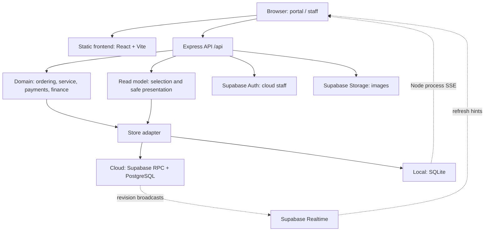
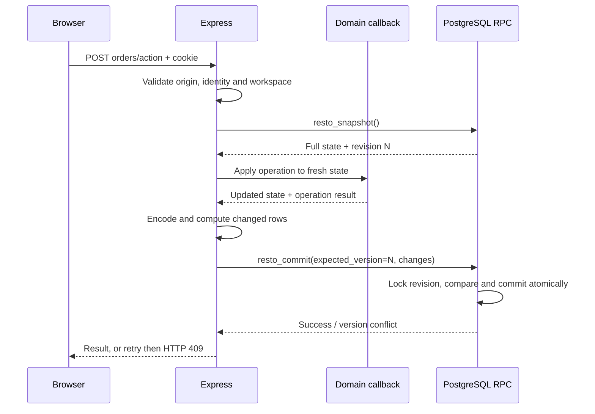

# 02 — System design

[README](../README.md) · [Data model](03-DATA-MODEL.md) · [Infrastructure](04-INFRASTRUCTURE-AND-ALTERNATIVES.md)

## 1. Architecture

restoOS is a modular monolith: one React application and one Express API with shared domain logic. It does not use Next.js, microservices, an ORM or a dedicated message broker.

The two persistence paths are alternatives, not automatic SQLite/PostgreSQL replication. Demo mode is a third, isolated path.

Browsers do not query business tables directly. Express validates identity, workspace, input and business rules. Direct browser connections to Supabase carry restricted/public Realtime credentials, never the server secret.

## 2. Module map

| Location | Responsibility |
| --- | --- |
| `src/main.jsx` | Application bootstrap, page/workspace selection, portal and state coordination |
| `src/StaffWorkspaces.jsx`, `Customers.jsx`, `CreateOrder.jsx`, `TransactionPanels.jsx` | Staff workflows and customer service |
| `src/Finance.jsx`, `ManagementOverview.jsx`, `Menu*.jsx` | Finance, overview and catalog/import interfaces |
| `src/useLiveRefresh.js`, `shared/refresh-queue.js` | Change subscriptions, reconciliation and refresh coordination |
| `server/app.js` | Middleware, endpoints, cookies, authorization and side-effect coordination |
| `server/store.js` | Ordering/service/payment rules, merge, settings and SQLite adapter |
| `server/cloud-store.js` | State encoding/decoding, row diff, snapshot and cloud commit |
| `server/read-model.js` | Local read selection and safe response projection |
| `server/finance.js`, `shared/finance.js`, `shared/metrics.js` | Expense validation, ledger and calculations |
| `server/reports.js`, `server/menu-import.js` | XLSX reporting, catalog import and templates |
| `server/staff-auth.js`, `live-config.js`, `supabase.js` | Provider Auth, Realtime tokens and server client |
| `server/media.js`, `image-cleanup.js` | Image validation, upload and deferred deletion |
| `supabase/migrations/` | Tables, constraints, RPCs, grants, cron and broadcasts |
| `api/index.js` / `server/index.js` | Vercel entry / standalone Node entry |
| `tests/`, `scripts/` | Domain/API tests, deployment verification, backup and administration |

Shared modules keep concepts and calculations consistent across UI and server. Read selection also exists in SQL; maintaining parity with JavaScript remains a testing responsibility.

## 3. Read path

`GET /api/state` returns data for the current identity and page. The server derives scope from the stored workspace; a query parameter cannot independently grant management access.

| Scope | Relevant data |
| --- | --- |
| Portal | Catalog, public settings and minimal visit identity; no order/bill history |
| Kitchen | Actionable orders; portion price/payment fields removed |
| Waiter | Active transactions and their orders/payments, including older debt |
| Management overview | Period activity plus active transactions for all-time obligations |
| Management history | Historical transactions/orders and payment records |
| Management finance | Receipts and expenses without all portion detail |
| Management menu | Catalog without operational history |
| Management settings | Settings, staff profiles and at most 200 recent audit events |

Cloud reads use `resto_context` for session context and `resto_view` for selected data. SQL output is decoded into domain state and safely presented. Local mode uses `selectReadState` and `presentState`. Password hashes, internal sessions and ownership tokens are excluded from ordinary business responses.

A client supplies its known `version`. A match produces a small `unchanged` response rather than the full selected data. Version identity incorporates scope, period and user/workspace so unrelated reads do not share an inappropriate result. This is an application protocol, not an HTTP cache or materialized view.

Scoping reduces payloads but does not mean every view has server pagination. The finance UI shows 50 entries per page while its scope may still return a large collection of payments and expenses.

## 4. Write path and concurrency

The cloud adapter tries up to six times. When a snapshot is stale, the domain callback runs again against fresh state. It does not blindly replay stale row changes. Callbacks must be synchronous and may not return Promises. External side effects inside a retried callback would risk repetition.

The commit RPC locks one `revision` row using `FOR UPDATE`, checks the expected version, removes children before parents, upserts parents before children and increments the version. The mutation path rechecks the application session/workspace during retries.

SQLite uses `BEGIN IMMEDIATE`, reads the JSON state, applies the callback, saves the new JSON and commits. WAL and a five-second busy timeout are enabled. Local revision counters and subscribers live in process memory, so the intended local topology uses a single Node process.

**Main tradeoff:** cloud commits send row diffs, but every domain write still reads a full snapshot. Growing history increases transfer, memory allocation, encoding work and write latency. A global revision makes unrelated mutations compete. This simplifies cross-entity business rules but should not be assumed to support high throughput without measurement.

## 5. Idempotency and business conflicts

Order submission combines actor/browser identity with `requestId`. A recorded retry returns its previous result while its portal session remains valid. Closed/stale sessions reject replay instead of attaching it to a newer transaction.

Expenses use unique `requestId` values and compare repeated content. Reusing an ID with different expense details is rejected. Payments validate unpaid portions within the transaction, preventing the same portion from being paid twice by competing operations.

Price, availability, active-name, portion-state and session conflicts are business errors. HTTP 409 directs clients to refresh and review. Network failure after commit can still leave the caller uncertain; idempotency reduces duplicate effects but does not eliminate all ambiguity.

## 6. Screen synchronization

Cloud broadcasts use `resto:catalog` for catalog/settings revisions and `resto:staff` for staff state revisions. Payloads contain revision numbers only. Browsers fetch actual data from the authorized API.

`useLiveRefresh` coalesces nearby events with a 120 ms delay, subscribes before reconciling, and checks versions every 60 seconds when healthy or 15 seconds when disconnected. Hidden/offline screens skip periodic fetching; visibility/online events reconcile. Staff Realtime credentials are refreshed near expiry when possible.

Local mode uses Server-Sent Events at `/api/changes`. Server-to-browser notifications are sufficient because commands still use HTTP. Events are hints; persisted data is authoritative. Broadcast failure must not roll back a valid order or payment.

The portal does not subscribe to every staff event. It discovers closure/merge through state refresh, periodic reconciliation, visibility changes and submission validation; these changes are not guaranteed to appear instantly.

## 7. Effects outside the database

Images upload before their references commit. Old images are queued for cleanup after successful replacement/removal. An ambiguous commit error triggers reference checks before deleting a newly uploaded image, since the database may already reference it.

PostgreSQL and Storage do not share a distributed transaction. Deferred cleanup may remain after a provider failure and is retried on subsequent catalog/identity changes. Database backups alone do not include image objects.

XLSX exports read full state and construct workbooks in the request. There is no separate export worker or job queue. History size and function duration therefore matter.

## 8. Demo mode

`APP_DEMO_MODE` must equal `true` exactly. Browser localStorage holds fictional state. A fetch wrapper submits that state, a route and a command through `POST /api/demo`. The server uses `AsyncLocalStorage` to isolate state per request and returns updated state.

Web Locks serialize same-browser cross-tab changes where available. A demo staff identity allows workspace selection without real login. Guards reject live database, Auth, Storage and live-config access even if credentials exist.

Demo state is intentionally visitor-controlled. It is a showcase mechanism, not trusted financial storage or production authorization. Different browsers do not share a demo database. A Node API is still required; localStorage does not turn the app into a static-only site.

## 9. HTTP interface

This is the current route map, not a separate public integration contract. Most commands use JSON and same-origin cookies. File responses use XLSX content types.

| Method and route | Purpose | Access |
| --- | --- | --- |
| `GET /api/health` | Report selected mode; cloud performs a context RPC health check | Public |
| `GET /api/demo-config` | Identify demo mode before frontend initialization | Public |
| `GET /api/state` | Read selected page state, optionally using `view`, `start`, `version` | Server-derived scope |
| `GET /api/live-config` | Return notification connection configuration | Catalog for guests; staff credentials when eligible |
| `GET /api/changes` | SSE revision hints | Local mode only |
| `POST /api/login` | Authenticate and create an application session | Login throttling applies |
| `POST /api/workspace` | Set/reset the session workspace | Signed-in staff |
| `POST /api/logout` | Remove the application session and cookie | Current session |
| `POST /api/setup` | Create the first local admin | SQLite, server-local request, empty user set |
| `POST /api/users` | Create another staff account | Management |
| `POST /api/orders` | Submit items, prices, identity and idempotency key | Guest owner or Waiter |
| `POST /api/action` | Execute the selected domain/finance/catalog action | Action-specific workspace checks |
| `GET /api/menu-template` | Generate the current multilingual catalog template | Management |
| `POST /api/menu-import/preview` | Parse/validate a base64 XLSX and describe changes | Management |
| `POST /api/menu-import/commit` | Validate and atomically apply the previewed catalog revision | Management |
| `GET /api/reports` | Generate an integrated XLSX for optional UTC `start`/`end` bounds | Management |
| `POST /api/demo` | Run a supported route/command against supplied fictional state | Demo mode only |

Portal requests add `portal=1`, deliberately suppressing staff context even if the browser also has a staff cookie. A signed-in staff account without a selected workspace cannot use operational commands. Action checks remain in the domain as well as route coordination.

Typical responses use 400 for invalid input, 401 for missing/expired authentication, 403 for denied workspace/origin/setup access, 404 for missing routes/entities, 409 for stale or conflicting state, and 429 for throttling. Unexpected server failures return a generic message rather than raw error details. Cloud health does not validate Storage, Auth sign-in, Realtime or every business workflow; local health is not an independent database-integrity check.

## 10. Potential evolution

These changes are proposals, not implemented capabilities:

1. Measure snapshot size, latency and conflict rates.
2. Move hot commands such as payment/order submission into targeted SQL transactions while preserving invariants.
3. Add server-side history/finance pagination and aggregate read models where required.
4. Partition revision/locking only after preserving merge and cross-entity consistency.
5. Introduce workers/outbox processing for large exports or delivery-guaranteed external effects.

Microservices are not a prerequisite. Deeper store/command boundaries inside the monolith can address the immediate bottlenecks.

## Implementation references

[API](../server/app.js), [cloud store](../server/cloud-store.js), [domain/local store](../server/store.js), [read model](../server/read-model.js), [refresh](../src/useLiveRefresh.js), [live config](../server/live-config.js), [demo server](../server/demo.js), [demo browser](../src/demo.js), [optimized reads SQL](../supabase/migrations/20261025105125_optimized_reads_and_instant_accept.sql), [history receipt patch](../supabase/migrations/20261025111039_history_receipts_in_scoped_reads.sql).
