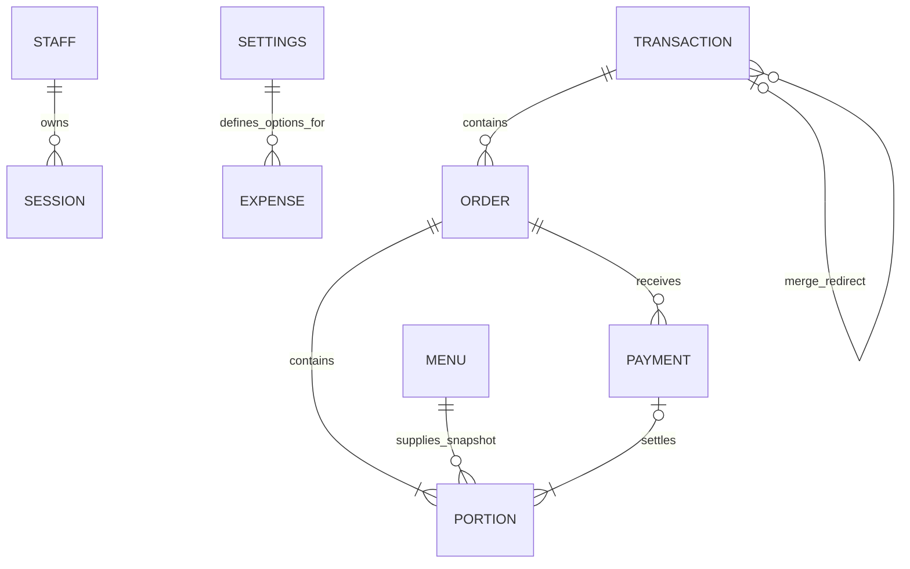

# 03 — Data model

[README](../README.md) · [System design](02-SYSTEM-DESIGN.md)

## 1. Logical relationships

The JavaScript domain operates on a state object containing arrays and keyed maps. Cloud persistence separates those entities into tables; local SQLite persists the complete object. The diagram shows logical associations, not a claim that every connection is enforced by a foreign key.



Menu deletion does not erase historical portions. A menu reference is not a requirement that the current catalog still contains that item; portions retain the information required for service and financial history.

## 2. Entity dictionary

### Restaurant settings

One settings object contains `name`, `tagline`, `primary`, `accent`, `logo`, `paused`, `currency`, and the compatibility field `autoAcceptSeconds` (currently zero). Finance initialization supplies `expenseCategories` and `paymentMethods`, whose entries have stable `id`, `name`, and `active` values.

Default expense labels are “Bahan baku,” “Peralatan,” “Gaji,” “Kemasan,” and “Lain-lain”; default payment methods are “Tunai” and “Transfer.” These are actual Indonesian application values, not documentation translations. Archiving an option prevents new selection without erasing recorded history.

The initial identity is `Restoran Anda`, base currency IDR, with empty operational data. Changing currency changes presentation/interpretation; it does not convert stored amounts. Configure it before recording activity.

### Menu item

| Field | Purpose |
| --- | --- |
| `id` | Stable item identity |
| `name`, `category` | Current display name and category |
| `price` | Positive integer price in the base currency |
| `description` | Default Indonesian description |
| `descriptionTranslations` | Language-code → text map |
| `available` | Whether new submissions may include this item |
| `photo` | Public image URL or empty string |

The catalog is mutable. Each new portion snapshots its name, category and price. Import matches normalized names, but IDs remain the relationships used by orders. The application does not model ingredient stock or quantity-based availability.

### Customer transaction: `tabs`

Typical fields are `id`, `name`, `token`, `createdAt`, `closedAt`, and optional `mergedInto`.

- `token` stores hashed browser ownership for portal-created transactions; staff-created transactions can have no guest token.
- `closedAt: null` means open. A completed transaction has a closure timestamp.
- `mergedInto` points to a surviving transaction. Source rows remain to preserve browser ownership but are excluded from normal lists/reports.
- The survivor's opening time becomes the earliest opening time among merged transactions.

There is no permanent customer table, table-number entity, branch ID, or tenant ID.

### Order: `orders`

Fields include `id`, `tabId`, `slug`, `createdAt`, `acceptedAt`, `acceptedBy`, `token`, `source`, `status`, and nested `units` in JavaScript. `source` distinguishes Portal and Garson. The slug is a readable identifier derived from name, transaction ID and order sequence; it is not the database primary key.

New orders are accepted immediately. Parent order status is not a full aggregate of every unit's current service state: delivery/readiness is tracked per unit, and a fully cancelled order is marked cancelled. Consumers should inspect units for actionable service work.

### Portion: `units` / cloud `portions`

Each quantity is expanded into individual units rather than stored only as a line-item quantity. Three drinks create three independently actionable portion records.

| Field | Purpose |
| --- | --- |
| `id`, `menuId` | Portion identity and source item |
| `name`, `category`, `price` | Historical item snapshots |
| `note` | Kitchen instruction copied from the submitted item |
| `status` | Service state: accepted, ready, delivered, cancelled; compatibility waiting/cooking |
| `paid`, optional `paymentId` | Independent payment state and receipt link |
| `readyAt`, `deliveredAt`, `cancelledAt` | Event timestamps when those transitions occur |
| `reason` | Cancellation explanation |
| `orderId` | Added when encoding into the separate cloud table |

There is no requirement to pay an entire order together or deliver all its portions at once.

### Payment: `payments`

Contains `id`, `orderId`, `tabId`, `unitIds`, `amount`, `method`, `methodId`, `at`, and `actor`. Amount is calculated from the selected unpaid, non-cancelled portions, not accepted as an arbitrary customer-entered total.

A payment settles portions from one order. Paying a transaction containing multiple orders therefore involves the relevant per-order actions. The model has no independent payment allocation to arbitrary future debt, partial payment of one portion, cash-change calculation, gateway reference lifecycle, or refund entity.

`methodId` links an editable option; `method` preserves its recorded name. Current reports may resolve the current option label while also including original labels in raw export data.

### Expense: `expenses`

Contains `id`, `requestId`, `at`, `amount`, `categoryId`, `category`, `methodId`, `method`, `party`, `note`, `reference`, `actor`, and `createdAt`.

`at` is the actual expense event time, while `createdAt` is recording time. Amount is a positive safe integer up to one trillion. Future event times are rejected. The receipt counterpart is a paid expense, not an unpaid supplier invoice. Repeated request IDs must carry matching content.

Expenses are append-only through the application. There is no edit/delete/correction flow. Category/method labels are snapshotted as well as linked by ID so archived options remain understandable.

### Staff, sessions and internal maps

| Collection | Contents |
| --- | --- |
| `users` | Staff profiles: ID, name, username/email; cloud Auth ID or local password hash |
| `sessions` | Hashed session token, user ID, expiry, selected `activeRole`; cloud Auth and Realtime credentials |
| `audit` | ID, UTC event time, actor display name, action and detail |
| `bans` | Guest hash → strikes, expiry and optional reset-order exclusions |
| `requests` | Idempotency key → previously committed operation result |
| `loginAttempts` | Hashed network address → recent attempt timestamps |

Cloud Auth credentials are managed by Supabase Auth rather than local password records. Actor names in payments/expenses/audit are display snapshots, not a complete immutable staff-identity ledger. Internal state and backups are sensitive even when browser API projections hide these fields.

## 3. Illustrative state fragment

This example omits unrelated fields and uses readable IDs instead of production UUIDs.

```json
{
  "tabs": [{"id":"t1","name":"Guest A","createdAt":"2026-10-28T12:00:00.000Z","closedAt":null}],
  "orders": [{
    "id":"o1","tabId":"t1","status":"accepted","createdAt":"2026-10-28T12:00:00.000Z",
    "units":[
      {"id":"u1","menuId":"m1","name":"Tea","category":"Drinks","price":10000,"status":"delivered","paid":true,"paymentId":"p1"},
      {"id":"u2","menuId":"m1","name":"Tea","category":"Drinks","price":10000,"status":"ready","paid":false}
    ]
  }],
  "payments":[{"id":"p1","orderId":"o1","tabId":"t1","unitIds":["u1"],"amount":10000,"method":"Tunai","methodId":"cash","at":"2026-10-28T12:05:00.000Z","actor":"Staff A"}]
}
```

Outstanding balance is 10,000. The transaction remains open because the second portion still needs both payment and delivery. The parent's accepted status does not overwrite either unit's state.

## 4. Physical storage: SQLite

The local database has a single `app` table with one row (`id = 1`) and a `body TEXT` column containing serialized state. It does **not** reproduce the cloud tables in SQLite.

The adapter opens `node:sqlite` synchronously, enables WAL and a busy timeout, and wraps state mutation in `BEGIN IMMEDIATE`/commit/rollback. This is simple for local use and isolated tests, but full-state parsing/stringification and synchronous work grow with history. Local relational integrity depends on domain validation rather than separate entity-table foreign keys.

The default file is `data/resto.sqlite`; an explicit `RESTO_DB` selects another file or `:memory:`. A file path requires persistent storage if the process is hosted remotely.

## 5. Physical storage: PostgreSQL

Business tables live in the unexposed `resto_private` schema. Most use a hybrid layout:

```sql
key text primary key,
position bigint not null default 0,
body jsonb not null
```

`key` stores identity, `position` preserves array ordering, and `body` retains entity payloads. Generated columns project selected JSON fields for indexing and constraints. This is neither one giant cloud JSON document nor a fully column-normalized SQL model.

Cloud tables include `settings`, `menu`, `tabs`, `orders`, `portions`, `payments`, `expenses`, `users`, `sessions`, `audit`, `bans`, `requests`, `login_attempts`, plus singleton `revision` with `version` and `catalog_version`.

Enforced examples include:

- Unique normalized names for open transactions.
- Foreign keys from orders to transactions, portions/payments to orders, sessions to users.
- Positive/range checks for portion prices and payment/expense amounts.
- Unique staff usernames and expense request IDs.
- Indexes for parent lookups and expense dates.

Not every logical association is a SQL foreign key. For example, menu references remain historical links, and portion payment IDs/unit allocation arrays are validated by the application. Domain rules still matter even with database constraints.

`encodeState` splits nested units into portions and maps token-keyed collections into rows. `decodeState` rebuilds the domain object. `stateChanges` computes upserts/deletes, including ordering changes. The revision lock makes the multi-table patch atomic; see [system design](02-SYSTEM-DESIGN.md).

## 6. Financial definitions and invariants

| Measure | Definition |
| --- | --- |
| Outstanding order balance | Sum of prices for unpaid, non-cancelled portions |
| Transaction balance | Sum of outstanding balances across its orders |
| Sales | Non-cancelled ordered portion value, associated with order time |
| Receipts | Payment amounts, associated with payment time |
| Expenses | Paid expense amounts, associated with expense event time |
| Net recorded cash movement | Receipts minus expenses |
| Popular-menu quantity | Ordered portions minus cancellations, independent of payment |

Invariants include: no payment for cancelled/already-paid units; no cancellation of paid/delivered units; closure only after every obligation is finished; no implicit new portal session from stale submissions; and preservation of order/payment identity during merges.

Money uses whole-number values with no currency conversion or fractional-unit model. Reporting is not double-entry accounting and does not model capital, assets, depreciation, tax liabilities or bank reconciliation. Net cash movement must not be described as profit.

## 7. Reporting time and XLSX behavior

Stored timestamps use UTC ISO strings. UI date choices use device-local time and are converted to UTC bounds. Report ranges are start-inclusive and end-exclusive. Excel timestamps remain UTC.

The export includes supporting history before the selected period to compute opening recorded cash and debt as of the end boundary. Cancellation timestamps affect historical debt calculations. Old portions without category snapshots fall back to the current catalog category or an explicit unknown-history label.

Workbook sheets include summary, guidance, raw transactions/items/payments/expenses, transaction balances, ledger, and financial/menu/category breakdowns. Formula ranges cover the exported rows. Formula results can change when existing raw rows are edited, but the file has no live database connection and new rows do not automatically extend every report range.

## 8. Migration history

Apply SQL files in filename order, including patches. The initial migration creates private storage and snapshot/commit RPCs. Later migrations add audit identity, maintenance, expenses/payment-method links, scoped reads, immediate acceptance, private Auth context and historical payment reads.

Reading only the first migration is misleading: it includes an acceptance scheduler that the optimized-read migration removes. The latest effective schema is the result of the whole sequence. SQLite has separate initialization/compatibility logic and does not execute these migrations.

## Implementation references

[Domain/local storage](../server/store.js), [encoding and diff](../server/cloud-store.js), [finance rules](../server/finance.js), [financial helpers](../shared/finance.js), [report workbook](../server/reports.js), [initial SQL](../supabase/migrations/20261024091006_resto_production_storage_and_transactions.sql), [expenses](../supabase/migrations/20261024143907_management_finance.sql), [optimized reads](../supabase/migrations/20261025105125_optimized_reads_and_instant_accept.sql).
